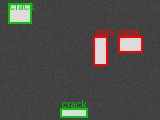

# image-label-toolkit

Python utilities for managing and checking image labelling data for machine learning. It covers the unglamorous work that decides whether a model trains on good data: finding bad files, validating boxes, measuring how well two labellers agree, and splitting data the same way every time.



*Synthetic image with labelled boxes drawn by `overlay`.*

## What it does

- **Index and check files** (`dataset.py`): stores each image's SHA-256, size and health in SQLite, flags corrupt or truncated files and groups exact duplicates.
- **Validate labels** (`dataset.py`): reports boxes with unknown classes, zero size or coordinates outside the image, and labels that point at missing images.
- **Labeller agreement** (`agreement.py`): matches boxes one-to-one by class and IoU, then reports precision, recall and F1 of one labeller against another.
- **Stable splits** (`split.py`): assigns each image to train or validation from a hash of its name, so adding new images never moves old ones between sets.
- **Visual review** (`overlay.py`): draws coloured boxes and class names on images for a quick check by eye.
- **Sample data** (`synth.py`): generates synthetic images with bright "defect" blobs and ground-truth boxes, so everything runs without real data.

## Run it

```bash
pip install -r requirements.txt
python -m pytest -q                                   # 8 tests

python -m imglabel.cli synth data -n 12               # make sample images + annotations.json
python -m imglabel.cli check data data/annotations.json
python -m imglabel.cli agree labeller_a.json labeller_b.json --iou 0.5
python -m imglabel.cli split data --val 0.2
python -m imglabel.cli overlay data data/annotations.json review
```

Annotation format: `{"image.png": [{"class": "pore", "x": 10, "y": 12, "w": 20, "h": 18}]}` with pixel coordinates from the top-left corner.

## Notes

- Matching is greedy (best IoU first). It is simple and fast; the Hungarian algorithm gives optimal matching on crowded images.
- Classes in `synth.CLASSES` are placeholders (`pore`, `crack`, `spatter`). Change them for your own data.
- Not built yet: polygon labels, an interactive labelling UI, COCO export.
